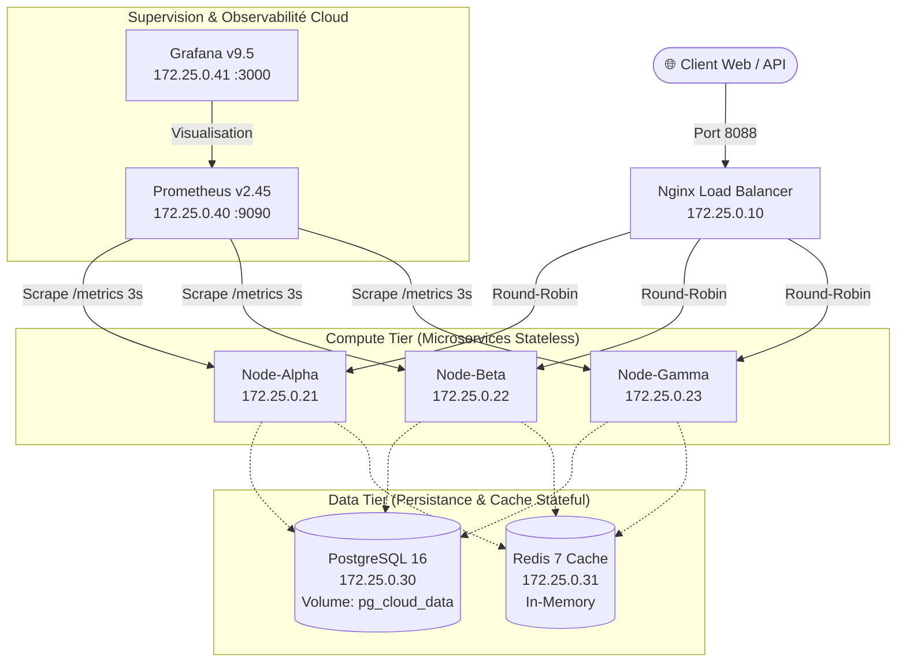

# RAPPORT DE PROJET : CLOUD & VIRTUALISATION

---

## **Projet : Conception et Déploiement d'une Infrastructure Cloud Native Résiliente, Haute Disponibilité et Observée (CloudSphere)**

- **Module :** Cloud Computing & Virtualisation
- **Date de Soutenance :** Samedi 21 Novembre (Avant 12h)
- **Taille du Groupe :** 4 Personnes

---

## 👥 1. Composition de l'Équipe & Répartition des Rôles

Afin de respecter les standards industriels et les méthodologies agiles DevOps, le projet a été structuré en 4 pôles de compétences complémentaires :

| Nom de l'Étudiant | Rôle Assigné | Responsabilités Clés |
|---|---|---|
| **Membre 1** | **Ingénieur DevOps & Virtualisation (Lead)** | Conception de l'architecture d'isolation, Dockerfiles multi-étapes, stratégie de conteneurisation Alpine, orchestration des services via Docker Compose et cycle de vie. |
| **Membre 2** | **Développeur Microservices & Backend Cloud** | Implémentation du service applicatif Python Flask multi-threads (Gunicorn), gestion des sessions distribuées, intégration du client Prometheus et endpoints de santé (*Healthchecks*). |
| **Membre 3** | **Architecte Réseau Cloud & Sécurité** | Conception du Software-Defined Network (SDN) en adressage privé CIDR `172.25.0.0/16`, configuration du Reverse Proxy et Load Balancer L7 Nginx, gestion du basculement automatique (*failover*). |
| **Membre 4** | **Ingénieur Observabilité & SRE (Site Reliability Engineer)** | Définition des SLO/SLI, configuration de la collecte de métriques Prometheus, création et automatisation du tableau de bord Grafana temps réel, script de simulation de trafic. |

---

## 📖 2. Contexte & Problématique Industrielle

Dans les architectures monolithiques traditionnelles hébergées sur serveurs physiques dédiés (*bare-metal*), les entreprises font face à des limitations critiques :
1. **Gaspillage des ressources physiques :** Taux d'utilisation CPU/RAM souvent inférieur à 15%.
2. **Point unique de défaillance (*Single Point of Failure - SPOF*) :** Toute panne matérielle ou crash d'application provoque une indisponibilité totale du service.
3. **Incapacité à passer à l'échelle (*Scaling*) :** La montée en charge nécessite l'achat coûteux de matériel plus puissant (scalabilité verticale).
4. **Opacité de l'état système :** Absence de métriques fines en temps réel pour anticiper les congestions.

### Objectifs du Mini-Projet :
L'objectif de ce projet est de concevoir, implémenter et valider une plateforme Cloud complète répondant aux exigences suivantes :
- **Virtualisation légère :** Découpage en micro-services isolés par conteneurs.
- **Haute Disponibilité (HA) & Équilibrage de Charge :** Répartition transparente du trafic sur un pool d'instances avec tolérance aux pannes à chaud.
- **Découplage État / Traitement :** Séparation stricte entre les nœuds applicatifs sans état (*Stateless*) et la couche de persistance/cache (*Stateful*).
- **Observabilité continue :** Tableau de bord dynamique permettant de superviser les transactions par seconde, le temps de réponse et l'état des nœuds.

---

## 🔬 3. Fondements Théoriques : Virtualisation & Modèles Cloud

### 3.1. Hyperviseurs vs Conteneurs (Virtualisation d'OS)

```
        VIRTUALISATION MATÉRIELLE                VIRTUALISATION PAR CONTENEURS
             (Hyperviseur Type 2)                             (Docker / CaaS)
    ┌───────────────────────────────────┐        ┌───────────────────────────────────┐
    │  App A   │  App B   │    App C    │        │  App A   │  App B   │    App C    │
    ├──────────┼──────────┼─────────────┤        ├──────────┼──────────┼─────────────┤
    │ Bins/Lib │ Bins/Lib │  Bins/Lib   │        │ Bins/Lib │ Bins/Lib │  Bins/Lib   │
    ├──────────┼──────────┼─────────────┤        ├───────────────────────────────────┤
    │ Guest OS │ Guest OS │  Guest OS   │        │       Moteur de Conteneur         │
    │ (Linux)  │ (Windows)│   (Linux)   │        │             (Docker)              │
    ├───────────────────────────────────┤        ├───────────────────────────────────┤
    │       Hyperviseur (KVM/VirtualBox)│        │      Noyau de l'OS Hôte           │
    ├───────────────────────────────────┤        │   (Namespaces, cgroups, chroot)   │
    │             OS Hôte               │        ├───────────────────────────────────┤
    ├───────────────────────────────────┤        │             Matériel              │
    │             Matériel              │        │        (CPU, RAM, Disque)         │
    └───────────────────────────────────┘        └───────────────────────────────────┘
```

* **Hyperviseurs (Type 1 Bare-Metal / Type 2 Hosted) :** Virtualisent le matériel complet. Chaque machine virtuelle (VM) embarque son propre noyau d'OS, nécessitant plusieurs gigaoctets de disque et des minutes de démarrage.
* **Conteneurs (CaaS - Utilisé dans notre projet) :** Partagent le noyau unique de l'hôte Linux tout en garantissant une isolation stricte grâce aux fonctionnalités natives du noyau :
  - **Namespaces :** Isolation des processus (`PID`), des interfaces réseau (`NET`), des points de montage (`MNT`), et des utilisateurs (`USER`).
  - **Control Groups (cgroups) :** Banalisation et restriction de la consommation mémoire, CPU et I/O disque.
  - **Avantages constatés :** Démarrage des conteneurs en quelques millisecondes, empreinte mémoire de seulement ~30 Mo par instance, portabilité universelle.

### 3.2. Modèles de Service Cloud (IaaS, PaaS, SaaS, CaaS)
- **IaaS (*Infrastructure as a Service*) :** Fourniture de ressources brutes (réseaux, machines virtuelles, stockage).
- **CaaS (*Container as a Service*) :** Notre projet s'inscrit au cœur de ce modèle. L'infrastructure orchestre des conteneurs standardisés, découplant totalement le code applicatif de la machine physique.
- **PaaS (*Platform as a Service*) :** Abstraction complète où le développeur ne fournit que le code source (ex. Heroku, GCP App Engine).

---

## 🏛️ 4. Architecture Détaillée de la Solution "CloudSphere"

La solution déploie 7 conteneurs répartis sur un réseau virtuel privé dédié (`cloud_net`) :



### 4.1. Réseau Virtuel Dédié (Software-Defined Network)
- **Sous-réseau :** `172.25.0.0/16`
- **Passerelle (Gateway) :** `172.25.0.1`
- **Isolation :** Les conteneurs communiquent entre eux par résolution DNS interne de Docker (ex. `postgres`, `redis`). Seuls les ports nécessaires sont exposés vers la machine hôte :
  - Port `8088` (Point d'entrée Nginx Load Balancer)
  - Port `3000` (Interface de visualisation Grafana)
  - Port `9090` (Serveur Prometheus)

### 4.2. Équilibrage de Charge (Load Balancing L7 Nginx)
Le Reverse Proxy applique un algorithme **Round-Robin** équitable sur le cluster des trois nœuds.  
Configuration clé (`nginx.conf`) :
```nginx
upstream backend_cluster {
    server app-node-1:5000 max_fails=2 fail_timeout=3s;
    server app-node-2:5000 max_fails=2 fail_timeout=3s;
    server app-node-3:5000 max_fails=2 fail_timeout=3s;
}
```
Grâce à la directive `proxy_next_upstream error timeout http_502;`, si un conteneur subit un crash inopiné, la requête en cours est immédiatement réacheminée vers un nœud sain sans que l'utilisateur ne reçoive d'erreur 500 ou 502.

### 4.3. Découplage de la Persistance (Stateful vs Stateless)
- **Stateless (Nœuds App) :** Les conteneurs `Node-Alpha`, `Node-Beta` et `Node-Gamma` ne conservent aucun état local sur disque. Ils peuvent être détruits, redémarrés ou dupliqués à volonté sans perte d'information.
- **Stateful (PostgreSQL & Redis) :** Les données de la base PostgreSQL sont montées sur un volume managé Docker (`pg_cloud_data`). Même en cas de suppression complète des conteneurs, les données métiers restent conservées intactes sur le système hôte.

---

## 📊 5. Observabilité & Mesures de Performance

### 5.1. Métriques Exportées (Prometheus)
Chaque nœud applicatif intègre nativement la bibliothèque officielle `prometheus_client` et expose sur `/metrics` :
- `cloud_http_requests_total` : Compteur de requêtes découpé par nœud, endpoint et code statut HTTP.
- `cloud_http_request_duration_seconds` : Histogramme de latence des requêtes.
- `cloud_active_connections` : Jauge de charge instantanée par conteneur.
- `cloud_cache_operations_total` : Ratio de Cache Hits / Misses.

### 5.2. Résultats du Benchmark Cache (Redis vs DB)
Lors des tests d'injection de requêtes :
- **Requête sans cache (accès PostgreSQL direct) :** `~60.8 ms`
- **Requête avec cache Redis (*In-Memory*) :** `~1.8 ms`
- **Constat :** Accélération d'un facteur **> 30x**, réduisant drastiquement la sollicitation du processeur et du disque.

---

## 🎯 6. Scénario de Démonstration en Direct (Avant 12h)

Pour la soutenance devant le jury, la démonstration est entièrement orchestrée par le script `scripts/demo.sh` :

1. **Étape 1 : Présentation de l'infrastructure**
   - Affichage de `docker-compose ps` montrant les 7 conteneurs avec statuts `Up (healthy)`.
   - Ouverture du navigateur sur `http://localhost:8088`.
2. **Étape 2 : Démonstration du Load Balancing**
   - Envoi de 9 requêtes via le terminal ou rafraîchissement web.
   - Constat de la distribution cyclique : `Node-Alpha` ➔ `Node-Beta` ➔ `Node-Gamma`.
3. **Étape 3 : Test de Résilience / Crash à chaud (*Chaos Engineering*)**
   - Exécution de `docker stop cloud_app_node_2`.
   - Envoi immédiat de rafales de requêtes : le service reste disponible à 100% avec temps de réponse normal grâce au basculement Nginx sur Alpha et Gamma.
   - Relance du conteneur via `docker start cloud_app_node_2` et réintégration instantanée sans reconfiguration manuelle.
4. **Étape 4 : Validation de la Persistance des données**
   - Ajout d'une tâche via le formulaire web sur un nœud.
   - Requête de lecture effectuée sur un autre nœud : la donnée est immédiatement visible (volume partagé).
5. **Étape 5 : Visualisation des Métriques en Temps Réel**
   - Lancement du générateur de charge (`scripts/load_generator.py 100 10`).
   - Projection du tableau de bord Grafana (`http://localhost:3000`) : observation des pics de RPS (Requêtes par seconde) et de la répartition par conteneur.

---

## 🔮 7. Conclusion & Perspectives d'Évolution

Ce mini-projet a permis de mettre en œuvre concrètement l'ensemble des concepts fondamentaux de l'ingénierie Cloud et de la virtualisation :
- Gestion du cycle de vie des conteneurs et isolation des ressources.
- Architecture résiliente et élastique sans point unique de panne (SPOF).
- Modèle d'observabilité moderne conforme aux standards de l'industrie (Prometheus/Grafana).

### Évolutions Futures possibles :
1. **Migration vers Kubernetes (K8s) :** Remplacement de Docker Compose par des manifestes K8s (Deployments, Services, Ingress Controller, StatefulSet) avec auto-scaling horizontal dynamique (*HPA - Horizontal Pod Autoscaler* basé sur la charge CPU).
2. **Pipeline CI/CD GitOps :** Automatisation des tests et du déploiement continu à l'aide de GitHub Actions et ArgoCD.
3. **Chiffrement de bout en bout (TLS/SSL) :** Mise en place de certificats Let's Encrypt gérés automatiquement par un reverse proxy Traefik ou Nginx Ingress.
